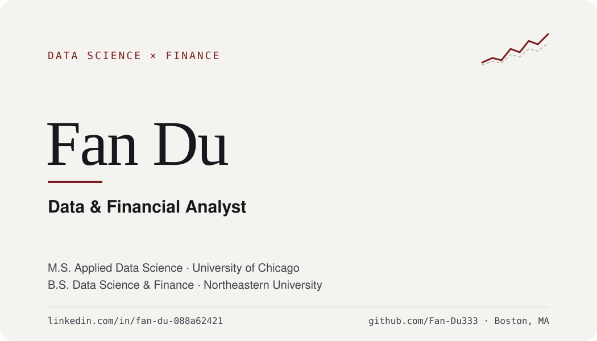

# Fan Du

### Data & Financial Analyst — Incoming M.S. in Applied Data Science, University of Chicago | B.S. Data Science & Finance, Northeastern University

I work where data science meets finance — building models that forecast markets, and turning financial statements and industry data into decisions people can act on.

**Data Science & Finance at Northeastern University**, then the **M.S. in Applied Data Science at the University of Chicago**. Along the way: deep-learning stock forecasting at a Silicon Valley startup, and investment-oriented market and business analysis for a Beijing research firm.

---

## What I've built

**Deep-learning stock price forecasting — VisionX** — implemented and compared LSTM, CNN, and BiLSTM models in Python to forecast market trends, with an end-to-end pipeline from raw market data to trained model.

**Feature pipeline with technical indicators** — collected and preprocessed historical market data from Yahoo Finance and engineered technical-indicator features as model inputs; tuned performance through feature engineering and hyperparameter search, evaluated across multiple metrics.

**Interactive prediction app** — a Tkinter desktop application that lets users configure prediction settings and visualize forecast results.

**Investment research across industries — Analysys International** — market research and business case analysis using financial reports and industry databases to evaluate investment opportunities and support recommendations.

---

## How I work

| As a data scientist | As a financial / business analyst |
| --- | --- |
| Build and compare deep-learning models (LSTM, CNN, BiLSTM) for time-series forecasting | Analyze financial statements, industry trends, and business models |
| Engineer features from raw market data and technical indicators | Synthesize qualitative and quantitative data into competitive advantages, risks, and growth opportunities |
| Evaluate with multiple metrics; tune via feature engineering and hyperparameters | Turn research into PowerPoint narratives for decision-makers |
| Ship results as usable tools, not just notebooks | Deliver structured analyses with actionable recommendations as part of a team |

---

## Domains

---

## Stack

**Data Science & ML**

**Analysis & Communication**

**Build & Ship**

---

## Experience

**Business Analyst Intern — Analysys International** · Beijing (remote) · Oct 2025 – Dec 2025
Market research, financial statement analysis, and business case evaluation to support investment recommendations and strategic decisions.

**Data Science Intern — VisionX** · Silicon Valley (hybrid) · Aug 2025 – Oct 2025
Built a deep-learning stock price prediction system and interactive forecasting app in Python.

---

## Education

**M.S., Applied Data Science — University of Chicago** · Jul 2026 – Dec 2027 (incoming)

**B.S., Data Science and Finance — Northeastern University** · Sep 2022 – Jun 2026

---

## Skills

Strategic Analysis · Competitive Analysis · Market Research · Financial Analysis · Business Analysis · Data Visualization · Machine Learning · NumPy · Pandas · GitHub

Open to data science, financial analysis, and business analytics roles — New York and beyond, on-site, hybrid, or remote.
